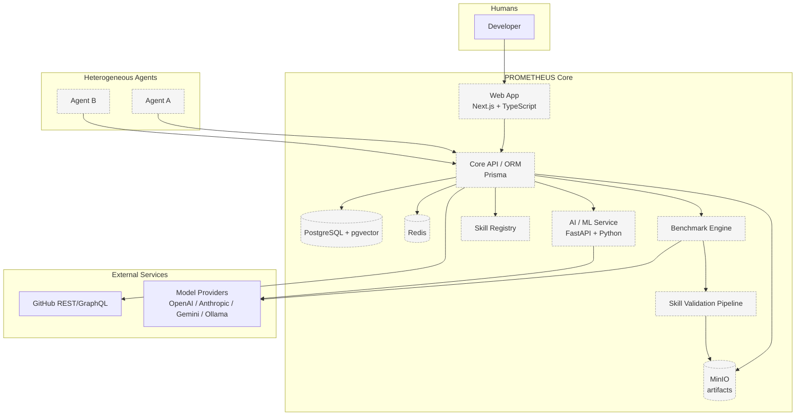

# PROMETHEUS Architecture (Summary)

> Status: **Proposed.** This document is a concise entry point. The authoritative architectural
> documents live under [docs/architecture/](docs/architecture/README.md). No architecture
> described here is implemented; the repository currently contains documentation only.

## Architectural Summary

PROMETHEUS is a decentralized framework for exchanging independently validated engineering
skills between heterogeneous AI agents. Architecturally it separates five concerns:

1. **Identity & evidence** — developers, agents, and models are distinct entities; public GitHub
   evidence is used to estimate *human* capability, while benchmarks measure *agent* capability.
2. **Agent interoperability** — a provider-agnostic `AgentAdapter` abstraction isolates the core
   from specific model vendors.
3. **Skills** — portable capability packages with metadata, instructions, tool/permission
   requirements, tests, evaluation info, provenance, and lineage.
4. **Benchmarking & validation** — controlled, sandboxed evaluation of agents and of candidate
   skills against a specific agent.
5. **Discovery, transfer & evolution** — vector retrieval to find *relevant* candidates, followed
   by benchmark-based validation to decide what *improves* an agent, plus versioning and lineage.

## High-Level Diagram

Dashed/filled nodes indicate **planned** components.

## Core Principles

- **Model and agent are different.** PROMETHEUS models `Developer → Agent → Model`, and agent
  identity is stable even when its underlying model changes.
- **Interoperability over vendor lock-in.** Provider-specific adapters implement a common
  `AgentAdapter` contract.
- **Skills are portable capability packages, not model weights.**
- **Skills must be independently validated.** Evaluate `SkillUtility(skill, agent)`, not assumed
  universal quality.
- **Vector similarity is not skill quality.** Retrieval finds relevance; benchmarking establishes
  improvement.
- **GitHub evidence and agent capability are separate measurements.**

## Where To Go Next

| Topic | Document |
|-------|----------|
| System decomposition | [docs/architecture/system-architecture.md](docs/architecture/system-architecture.md) |
| Component boundaries | [docs/architecture/component-boundaries.md](docs/architecture/component-boundaries.md) |
| Data flow | [docs/architecture/data-flow.md](docs/architecture/data-flow.md) |
| Database/entity model | [docs/architecture/database-architecture.md](docs/architecture/database-architecture.md) |
| Security | [docs/architecture/security-architecture.md](docs/architecture/security-architecture.md) |
| Decisions | [docs/decisions/](docs/decisions/README.md) |
