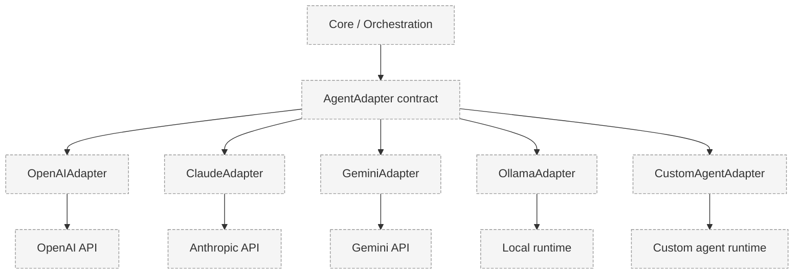

# Agent Adapter

> Status: **Proposed.** No adapter is implemented. See
> [ADR-005](../decisions/ADR-005-custom-agent-adapter.md) for why PROMETHEUS owns this
> abstraction.

## Problem

Heterogeneous agents use different models, SDKs, and runtimes. The core must execute agents,
measure them, and exchange skills without knowing vendor specifics. Without a common contract,
every new provider would leak into the core.

## Context

- Providers include OpenAI, Anthropic/Claude, Gemini, Ollama/local models, and custom agents.
- Benchmarks and skill validation must invoke agents uniformly.
- Skill transfer must move capabilities between unlike agents.
- The contract must stay minimal to avoid re-implementing a large agent framework.

## Design

PROMETHEUS plans a common `AgentAdapter` abstraction. Each provider has an implementation:

```
AgentAdapter (conceptual contract)
├── executeTask()
├── reportCapabilities()
├── runBenchmark()
├── offerSkills()
├── receiveSkills()
├── communicate()
└── reportMetadata()
```

Provider-specific implementations may include `OpenAIAdapter`, `ClaudeAdapter`, `GeminiAdapter`,
`OllamaAdapter`, and `CustomAgentAdapter`.

> This is an architectural contract, not an interface definition or implementation. Signatures,
> types, and error semantics are not finalized.

### Conceptual Operations

| Operation | Purpose |
|-----------|---------|
| `executeTask` | Run a task and return a normalized result. |
| `reportCapabilities` | Describe what the agent can currently do. |
| `runBenchmark` | Execute a benchmark task set and return measurements. |
| `offerSkills` | Enumerate skills the agent can export. |
| `receiveSkills` | Accept a skill package for installation. |
| `communicate` | Structured message exchange between agent and platform. |
| `reportMetadata` | Provider, model, tools, and runtime metadata. |

## Architecture



## Responsibilities

- Normalize provider responses into a common result shape.
- Report honest metadata (provider, model, runtime) for benchmark records.
- Enforce that skills received are validated before installation (delegated to orchestration).
- Never surface credentials to the agent or to untrusted code.

## Trade-offs

- A minimal contract keeps maintenance low but may not expose provider-specific strengths.
- A custom abstraction costs engineering effort but preserves interoperability and research
  independence (contrast with adopting a large third-party framework, which would couple the core
  to that framework's model of agents).

## Open Questions

- What is the minimal result schema that benchmarks require?
- How are streaming, multi-turn, and tool-using interactions normalized?
- How should capability reporting be trusted, given an agent could misreport?

## Future Work

- A conformance test suite that every adapter must pass.
- Capability negotiation and graceful degradation across providers.

## Related Documents

- [Agent Model](agent-model.md)
- [Capability Model](capability-model.md)
- [Benchmark Execution](../benchmarks/benchmark-execution.md)
- [ADR-005](../decisions/ADR-005-custom-agent-adapter.md)
