# Component Boundaries

> Status: **Proposed.**

## Problem

Without explicit boundaries, responsibilities blur: benchmark logic leaks into the UI, provider
specifics leak into the core, and trust decisions leak into execution. PROMETHEUS needs clear
ownership so components can be built, tested, and replaced independently.

## Context

- The core is TypeScript/Prisma; AI/ML and benchmark harness work is Python/FastAPI.
- Agents are heterogeneous and must not be known to the core domain.
- Untrusted code must run only in an isolated sandbox.

## Design — Boundary Map

```mermaid
flowchart LR
    subgraph Presentation["Presentation Layer"]
        UI["UI Components<br/>(profiles, registry, network view)"]
    end

    subgraph Domain["Domain Layer (TypeScript / Prisma)"]
        IDENT["Identity & Evidence"]
        AG["Agent Registry"]
        SK["Skill Registry"]
        CAP["Capability Profiles"]
    end

    subgraph Orchestration["Orchestration Layer"]
        WF["Skill/Benchmark Workflows<br/>validation pipeline"]
    end

    subgraph AIService["AI / ML Service (Python / FastAPI)"]
        EMB["Embeddings"]
        CODE["Code Analysis (Tree-sitter)"]
        HARNESS["Benchmark Harness"]
        ML["ML Models"]
    end

    subgraph Execution["Execution Layer"]
        SBX["Docker Sandbox"]
    end

    subgraph Integration["Integration Layer"]
        ADP["AgentAdapter implementations"]
        GHINT["GitHub Client"]
        PROVIDER["Model Providers"]
    end

    UI --> Domain
    Domain --> Orchestration
    Orchestration --> AIService
    Orchestration --> Execution
    Orchestration --> Integration
    AIService --> Integration

    classDef planned fill:#f5f5f5,stroke:#999,stroke-dasharray:4 2;
    class UI,IDENT,AG,SK,CAP,WF,EMB,CODE,HARNESS,ML,SBX,ADP,GHINT,PROVIDER planned;
```

## Responsibilities

### Presentation
- Render developer profiles, agent capability profiles, the skill registry, and the network view.
- Hold no business rules; delegate to the domain/API layer.

### Domain (TypeScript / Prisma)
- Own entities: developers, agents, models, skills, versions, benchmarks, results, lineage.
- Enforce invariants (e.g., a skill version is immutable once published).
- Expose persistence and query operations. Does not know model SDK specifics.

### Orchestration
- Implement workflows: ingestion, benchmarking, discovery, validation, transfer.
- Enforce the [security validation pipeline](security-architecture.md).
- Decide install vs. reject based on comparison results, using documented thresholds.

### AI / ML Service (Python / FastAPI)
- Produce embeddings and code representations (Tree-sitter, static analysis).
- Host the benchmark harness and ML models.
- Return structured results to orchestration. Owns no user-facing endpoints.

### Execution (Docker Sandbox)
- Run untrusted benchmark tasks and candidate skills in isolation.
- Capture diffs, logs, metrics, and test outcomes.
- Own no trust decisions; receives already-vetted work within policy.

### Integration
- `AgentAdapter` implementations translate the common contract into provider calls.
- GitHub client handles REST/GraphQL and rate limiting.
- Provider credentials are held here, server-side, never passed to agents.

## Boundary Rules

1. The domain layer never imports provider SDKs.
2. Agents never receive GitHub or provider credentials.
3. Untrusted code never executes outside the sandbox.
4. Cross-language interaction uses explicit, versioned schemas.
5. Trust decisions live only in orchestration, never in the execution layer.

## Trade-offs

- Cross-language boundary adds serialization and versioning overhead, but keeps AI/ML tooling in
  Python where it is strongest.
- Strict isolation slows iteration, but is required for safe skill exchange.

## Future Work

- Formalize the orchestration/ML contract as a versioned schema.
- Introduce a policy engine for permissions at the boundary.

## Related Documents

- [System Architecture](system-architecture.md)
- [Data Flow](data-flow.md)
- [Agent Adapter](../agents/agent-adapter.md)
