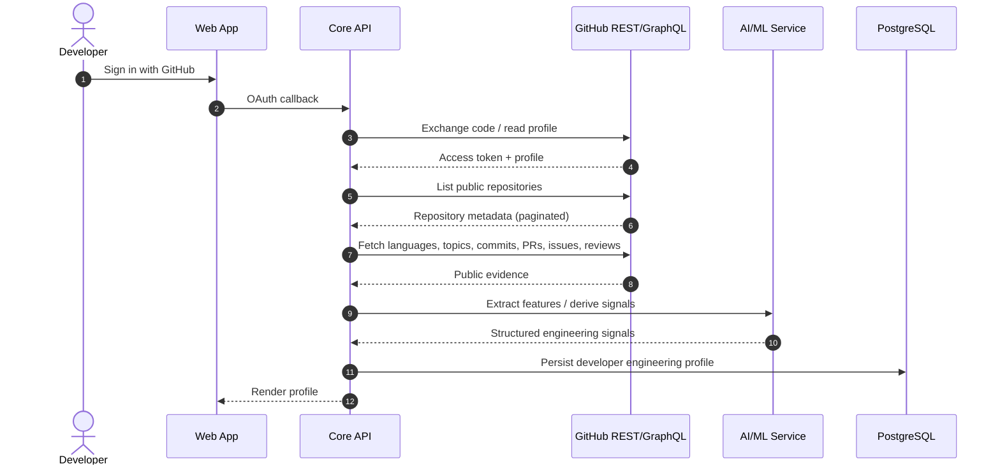
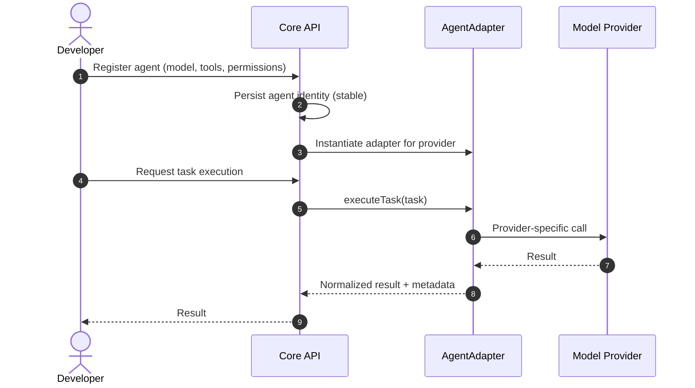
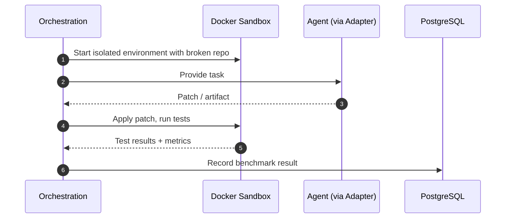
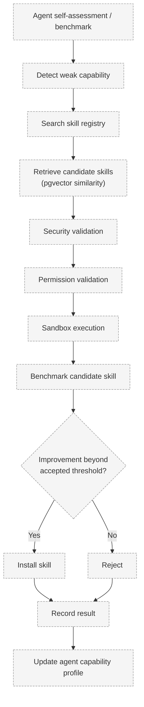
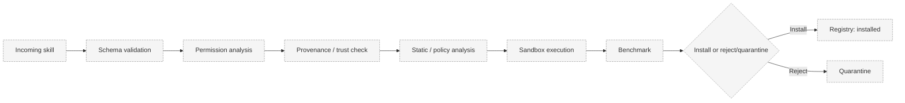

# Data Flow

> Status: **Proposed.** No flow is implemented; these are intended flows.

## Problem

PROMETHEUS spans human evidence, agent execution, skill storage, and sandboxed evaluation. Clear
flows are needed so each component's inputs and outputs are unambiguous.

## Context

- Ingestion is read-only against public GitHub data.
- Benchmarking and validation are sandboxed.
- Skill discovery uses vector retrieval; validation uses benchmarking.

## Flow 1 — GitHub Ingestion

Notes: private repositories are **out of scope** for V1. Rate limits and pagination must be
handled explicitly (see [Repository Ingestion](../github/repository-ingestion.md)).

## Flow 2 — Agent Integration

Agent identity remains stable if the underlying model changes (see
[Agent Model](../agents/agent-model.md)).

## Flow 3 — Benchmark Execution

Metrics recorded: task success, tests passed, execution time, token usage, tool calls, errors,
recovery behaviour, and code quality where measurable (see
[Benchmark Execution](../benchmarks/benchmark-execution.md)).

## Flow 4 — Skill Discovery and Transfer

Vector similarity determines *relevance*; benchmarking determines *improvement*. See
[Skill Discovery](../skills/skill-discovery.md) and [Skill Transfer](../skills/skill-transfer.md).

## Flow 5 — Skill Validation Pipeline

See [Skill Validation](../skills/skill-validation.md) and
[Security Architecture](security-architecture.md).

## Trade-offs

- Sequential validation is safer but slower; parallelizing independent checks requires care.
- Sandbox capture of full artifacts improves auditability at storage cost.

## Future Work

- Event-driven flows (queue-backed) via Redis.
- Incremental re-ingestion using GitHub webhooks.

## Related Documents

- [System Architecture](system-architecture.md)
- [Component Boundaries](component-boundaries.md)
- [Database Architecture](database-architecture.md)
