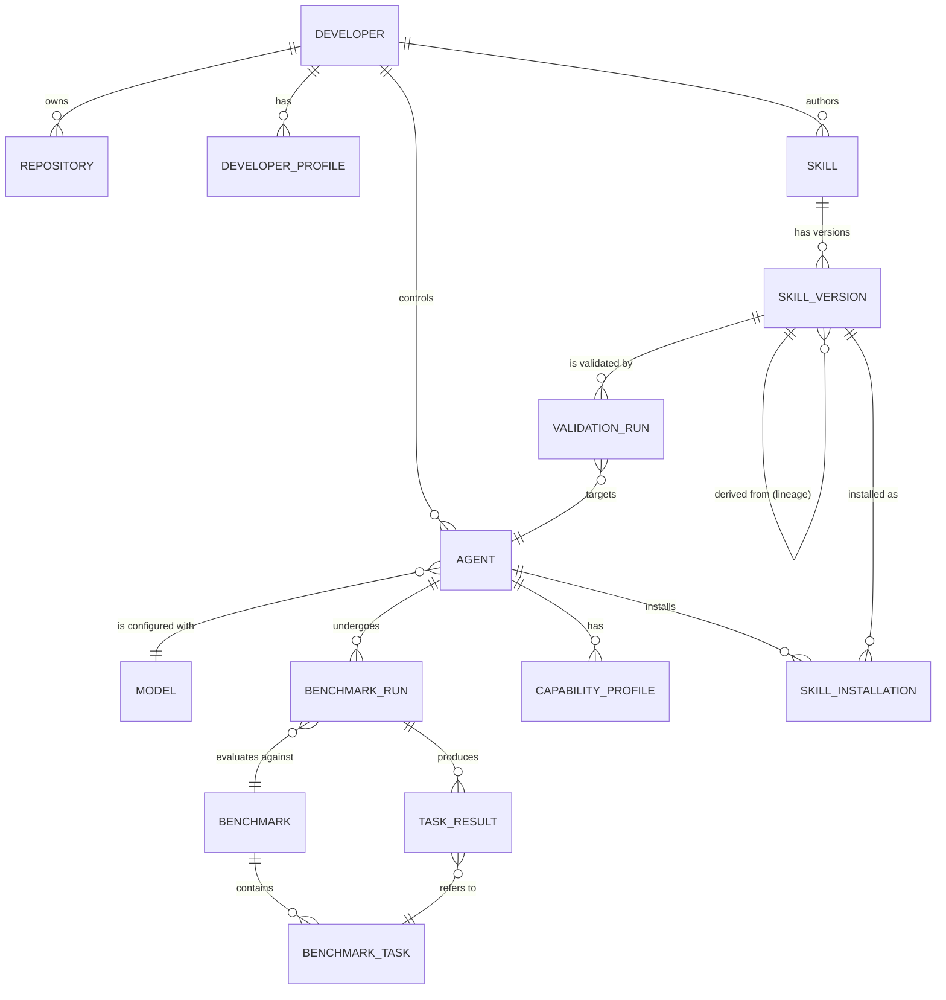

# Database Architecture

> Status: **Proposed.** No schema is implemented. This is the intended entity model, not a final
> specification. Do not treat this as a migration.

## Problem

PROMETHEUS must represent developers, agents, models, benchmarks, skills, versions, validation
results, and lineage — while keeping its vector index close to relational data for V1.

## Context

- PostgreSQL is the primary relational database ([ADR-001](../decisions/ADR-001-postgresql.md)).
- Prisma is the planned ORM ([ADR-002](../decisions/ADR-002-prisma.md)).
- pgvector provides V1 vector similarity search ([ADR-003](../decisions/ADR-003-pgvector.md)).
- Agent identity must be stable across model changes; skills are versioned and traced.

## Design — Entity Relationships

## Proposed Entities (Sketch)

> This is a conceptual sketch, not a schema. Field names and types are illustrative.

| Entity | Purpose | Key relations |
|--------|---------|---------------|
| `Developer` | Human identity via GitHub | owns repositories, controls agents |
| `DeveloperProfile` | Evidence-based engineering dimensions | belongs to developer |
| `Repository` | Public repo evidence | belongs to developer |
| `Agent` | Stable agent identity | configured with model, belongs to developer |
| `Model` | Provider + model identifier | referenced by agents |
| `CapabilityProfile` | Agent capability dimensions | belongs to agent |
| `Benchmark` | A task set / suite | contains tasks |
| `BenchmarkTask` | A single deterministic task | belongs to benchmark |
| `BenchmarkRun` | An execution of a benchmark by an agent | produces task results |
| `TaskResult` | Per-task outcome + metrics | belongs to run |
| `Skill` | A skill (logical, version-independent) | has versions, authored by developer |
| `SkillVersion` | Immutable published version | validated by validation runs, has lineage |
| `ValidationRun` | Candidate skill tested against an agent | targets agent, compares to baseline |
| `SkillInstallation` | A skill version installed for an agent | links agent and version |
| `SkillEmbedding` | Vector representation (pgvector) | belongs to skill version |

## Vector Storage

A `SkillEmbedding` table (or column) stores embeddings used for candidate retrieval. Similarity
search answers *relevance only*; it does not encode quality. See
[Skill Discovery](../skills/skill-discovery.md).

## Invariants (Proposed)

- A `SkillVersion` is immutable once published; changes create a new version.
- `BenchmarkRun` results are append-only.
- An `Agent` references a `Model` but its identity does not change when the model changes.
- `ValidationRun` must reference both a baseline and a candidate measurement.

## Security Considerations

- No secrets are stored in benchmark or skill records.
- GitHub tokens are stored encrypted and never joined into agent-visible payloads.

## Trade-offs

- Keeping vectors in PostgreSQL simplifies operations for V1 but may not scale; a dedicated vector
  store can be revisited.
- A rich lineage model is more complex than a flat skill table but is required for evolution.

## Future Work

- Indexing and partition strategy for large benchmark histories.
- Provenance/trust tables.
- Migration to a distributed vector store if scale demands it.

## Related Documents

- [ADR-001 PostgreSQL](../decisions/ADR-001-postgresql.md)
- [ADR-002 Prisma](../decisions/ADR-002-prisma.md)
- [ADR-003 pgvector](../decisions/ADR-003-pgvector.md)
- [Data Flow](data-flow.md)
