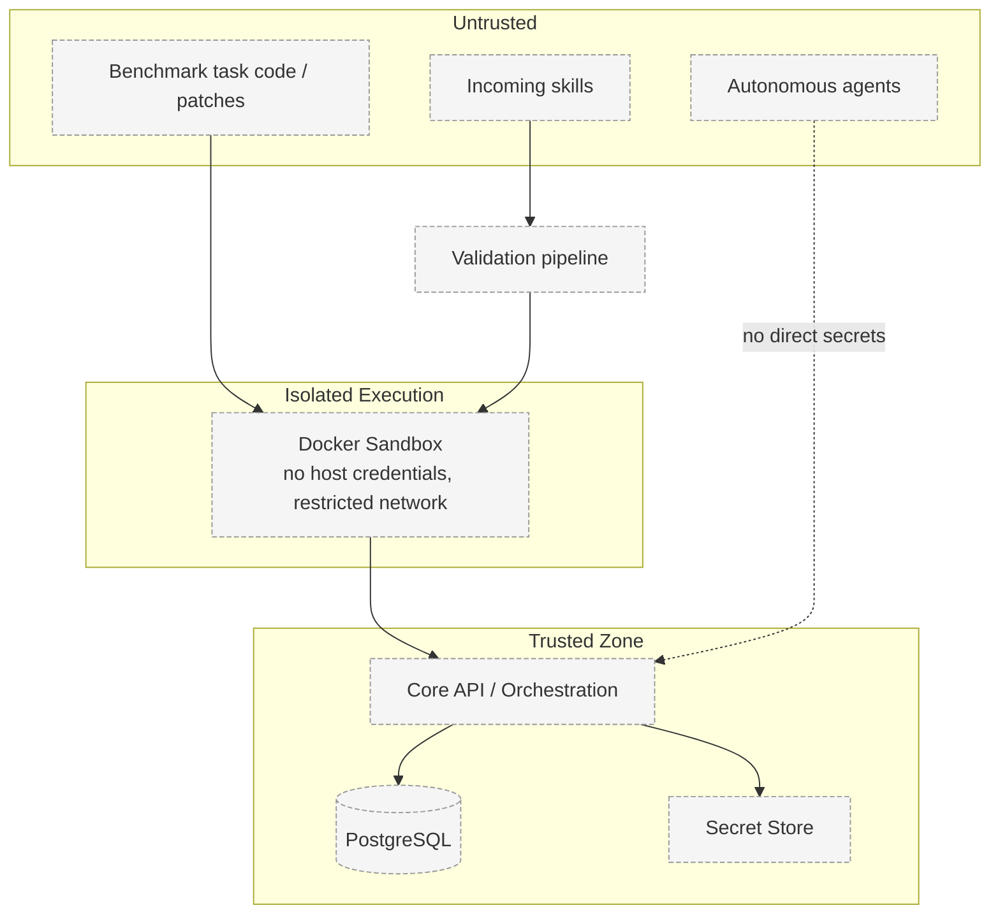

# Security Architecture

> Status: **Proposed.** No security control is implemented. This document describes intended
> trust boundaries and the proposed validation pipeline. See [SECURITY.md](../../SECURITY.md).

## Problem

Skill exchange means executing artifacts and code originating from other agents — potentially
hostile. PROMETHEUS must prevent untrusted skills and benchmark tasks from harming the platform,
user repositories, or credentials.

## Context

- Skills may declare dangerous permissions (`shell`, `network`, `filesystem.write`, …).
- Benchmark tasks and candidate skills are untrusted.
- GitHub access tokens and provider API keys are high-value secrets.
- Agents are autonomous by design, so human control must be explicit.

## Trust Boundaries



Key rule: **credentials never cross into the untrusted zone or the sandbox.**

## Proposed Validation Pipeline

```
Incoming Skill
  → schema validation
  → permission analysis
  → provenance / trust check
  → static / policy analysis
  → sandbox execution
  → benchmark
  → install OR reject / quarantine
```

Each stage:

1. **Schema validation** — reject malformed packages before anything executes.
2. **Permission analysis** — compare declared permissions against an allow-list and policy.
3. **Provenance / trust check** — verify origin, signature (future), and history.
4. **Static / policy analysis** — inspect instructions, scripts, and tool requirements.
5. **Sandbox execution** — run in an isolated Docker environment with no host secrets.
6. **Benchmark** — measure actual effect on the target agent.
7. **Decision** — install only on improvement beyond threshold; otherwise reject/quarantine.

## Permission Model

Skills must explicitly declare required permissions, for example:

| Permission | Meaning |
|------------|---------|
| `filesystem.read` | Read files in the scoped workspace |
| `filesystem.write` | Write files in the scoped workspace |
| `network` | Outbound network access |
| `shell` | Execute shell commands |
| `database.read` | Read from a permitted database |
| `database.write` | Write to a permitted database |

Dangerous capabilities are never silently granted. See
[Autonomy and Permissions](../agents/autonomy-and-permissions.md).

## Secret Handling

- GitHub credentials are never exposed directly to autonomous agents.
- Provider API keys are server-side only and injected into the AI/ML service and adapters, never
  into sandboxes or agent-visible payloads.
- Secrets are loaded from environment configuration (see
  [Environment Variables](../development/environment-variables.md)) and a secret store; they are
  never committed.

## Sandbox Controls (Proposed)

- No host filesystem mounts beyond a scoped workspace.
- Network disabled by default.
- CPU, memory, and wall-clock limits.
- Ephemeral containers, no privileged mode.

See [ADR-006](../decisions/ADR-006-docker-sandbox.md).

## Open Questions

- Which signature/provenance mechanism is feasible for V1?
- How should trust accumulate across lineage (does a derivative inherit trust)?
- What static-analysis coverage is realistic for arbitrary skill instructions?
- How is quarantine represented and reviewed?

## Trade-offs

- Strong isolation reduces risk but raises infrastructure and latency costs.
- Strict permission allow-listing limits some useful skills but is required for safety.

## Related Documents

- [Data Flow](data-flow.md) — validation flow
- [Skill Validation](../skills/skill-validation.md)
- [Autonomy and Permissions](../agents/autonomy-and-permissions.md)
- [ADR-006 Docker Sandbox](../decisions/ADR-006-docker-sandbox.md)
- [SECURITY.md](../../SECURITY.md)
