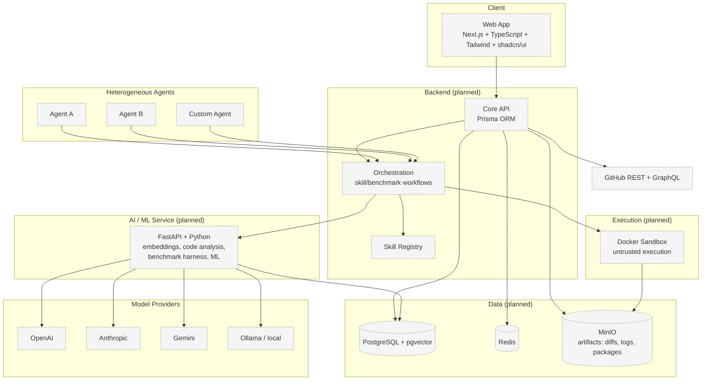

# System Architecture

> Status: **Proposed.**

## Problem

PROMETHEUS must connect human identity and public evidence, heterogeneous AI agents, a shared
skill registry, and a benchmark/validation engine — without coupling the core to any single model
vendor and without trusting untrusted skills.

## Context

- Agents differ in model, tools, memory, and runtime; the core must be provider-agnostic.
- Skills are untrusted and must be validated, not assumed safe.
- Evaluation must be reproducible and, where possible, deterministic.
- The system is research-oriented; V1 must remain small and verifiable.

## Design

PROMETHEUS separates five concerns: **identity & evidence**, **agent interoperability**,
**skills**, **benchmarking & validation**, and **discovery, transfer & evolution**.



All backend and runtime components are **planned**; dashed styling indicates not implemented.

## Responsibilities

| Component | Owns | Does not own |
|-----------|------|--------------|
| Web App | User interface, auth session, visualizations | Business rules, benchmark logic |
| Core API | Entities, persistence, orchestration entry points | Model-specific execution |
| Orchestration | Skill/benchmark workflows, validation pipeline | Provider SDK specifics |
| Skill Registry | Skill storage, versioning, lineage metadata | Skill execution |
| AI/ML Service | Embeddings, code analysis, benchmark harness, ML models | User-facing API |
| Docker Sandbox | Isolated untrusted execution | Trust decisions |
| AgentAdapter layer | Model/provider-specific execution behind a common contract | Core domain logic |

## Data Flow (Summary)

See [Data Flow](data-flow.md) for full diagrams. The canonical V1 flow:

```
Developer → GitHub Auth → Public Repo Analysis → Developer Profile
→ Agent Integration → Agent Benchmarking → Agent Capability Profile
→ Skill Registry → Skill Discovery → Skill Validation → Skill Transfer
→ Re-Benchmark → Measurable Capability Improvement
```

## Security Considerations

- Skill packages and benchmark tasks are **untrusted**; execution occurs in a Docker sandbox
  ([ADR-006](../decisions/ADR-006-docker-sandbox.md)).
- GitHub credentials are never exposed to autonomous agents.
- Provider API keys are server-side only (see [.env.example](../../.env.example)).
- Skills declare permissions explicitly; dangerous capabilities are not silently granted.

See [Security Architecture](security-architecture.md).

## Trade-offs

- A custom `AgentAdapter` adds maintenance cost but preserves vendor independence.
- Sandboxing adds latency and infrastructure cost but is required for safe skill exchange.
- Keeping the core in TypeScript/Prisma and Python in a separate service adds a boundary but lets
  each side use its strongest ecosystem.

## Future Work

- Distributed benchmark workers.
- Stronger provenance/trust scoring.
- Sandbox hardening and capability-based permission enforcement.

## Related Documents

- [Component Boundaries](component-boundaries.md)
- [Data Flow](data-flow.md)
- [Database Architecture](database-architecture.md)
- [Security Architecture](security-architecture.md)
