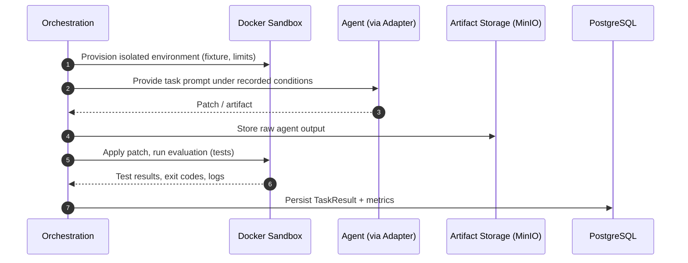

# Benchmark Execution

> Status: **Proposed.** See [ADR-006](../decisions/ADR-006-docker-sandbox.md).

## Problem

Benchmarks run untrusted agent output and untrusted task code. Execution must be isolated,
reproducible, and observable.

## Context

- Agents produce patches or artifacts that must be applied and tested.
- Task fixtures and skill tests are untrusted.
- Metrics must be captured consistently for comparison.

## Design

### Execution Flow

### Recorded Metrics

| Metric | Description |
|--------|-------------|
| task success | Whether the task's evaluation passed |
| tests passed | Count / fraction of tests passing |
| execution time | Wall-clock duration |
| token usage | Tokens consumed by the agent |
| tool calls | Number and type of tool invocations |
| errors | Errors encountered |
| recovery behaviour | Whether/how the agent recovered from failures |
| code quality | Where measurable (e.g., lint/static checks) |

### Isolation Controls

- Ephemeral Docker containers.
- No host credential mounts.
- Network disabled by default.
- CPU, memory, and wall-clock limits.

## Responsibilities

- Orchestration applies patches and invokes evaluation.
- The sandbox provides isolation and captures results.
- Artifact storage retains raw outputs and logs for audit.
- Persistence records structured results.

## Data Flow

See [Data Flow — Benchmark Execution](../architecture/data-flow.md#flow-3--benchmark-execution).

## Security Considerations

- Never inject provider or GitHub credentials into the sandbox.
- Treat all agent output as untrusted input to the sandbox.

## Trade-offs

- Isolation increases runtime but is mandatory for safety.
- Retaining full artifacts aids reproducibility at storage cost.

## Open Questions

- How is determinism guaranteed across host environments (base image pinning)?
- How to handle flaky tests without hiding real regressions?
- How to capture tool calls uniformly across heterogeneous adapters?

## Related Documents

- [Benchmark Design](benchmark-design.md)
- [Scoring](scoring.md)
- [Security Architecture](../architecture/security-architecture.md)
- [ADR-006 Docker Sandbox](../decisions/ADR-006-docker-sandbox.md)
