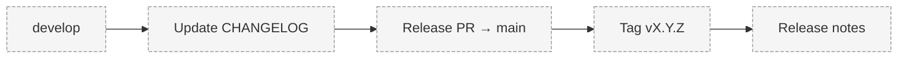

# Release Process

> Status: **Proposed.**

## Versioning

PROMETHEUS follows [Semantic Versioning](https://semver.org/) (`MAJOR.MINOR.PATCH`). Pre-1.0
releases (`v0.x`) are development milestones described in the [Roadmap](../02-roadmap.md).

## Process

1. Merge completed work into `develop` via reviewed pull requests.
2. Update [CHANGELOG.md](../../CHANGELOG.md) under `[Unreleased]`, then promote to the release
   version.
3. Open a release pull request from `develop` to `main`.
4. Review and merge; ensure CI passes.
5. Tag `main` with `vX.Y.Z`.
6. Publish release notes from the changelog.
7. Confirm documentation reflects the released state (statuses updated).

## Release Gates

- All CI checks pass (lint, typecheck, tests).
- Documentation updated in the same PRs as features.
- No secrets committed.
- Known limitations documented.

## Status Labels in Releases

Release notes must accurately reflect **Implemented**, **In Development**, **Experimental**,
**Planned**, and **Proposed** status. Do not claim planned functionality is operational.

## Open Questions

- Is CI/CD via GitHub Actions (Planned) the final mechanism?
- Are per-milestone tags (`v0.x`) published as GitHub Releases?

## Related Documents

- [Roadmap](../02-roadmap.md)
- [Git Workflow](git-workflow.md)
- [CHANGELOG.md](../../CHANGELOG.md)
