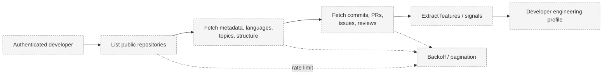

# Repository Ingestion

> Status: **Proposed.**

## Problem

To estimate human engineering capability, PROMETHEUS must ingest public repository evidence
reliably, at scale, and within GitHub API limits.

## Context

- V1 analyzes **public** repositories only.
- Ingestion uses GitHub REST and GraphQL APIs.
- Rate limits, pagination, and idempotency are real constraints.
- Evidence is inherently partial and must not be over-interpreted.

## Design

### Ingested Evidence (Potential)

- repository metadata
- languages
- topics
- commits
- pull requests
- issues
- reviews
- contribution history
- project longevity
- repository structure

### Ingestion Flow

### Handling Constraints

- **Pagination:** follow cursors/links until exhausted.
- **Rate limits:** respect `X-RateLimit-*` headers; back off and retry.
- **Idempotency:** re-ingestion must not duplicate records.
- **Incrementality:** future webhook-based updates (Planned).

## Responsibilities

- The GitHub client performs API calls and rate-limit handling.
- The AI/ML service extracts features and signals.
- The domain layer persists repositories and evidence.

## Data Flow

See [Data Flow — GitHub Ingestion](../architecture/data-flow.md#flow-1--github-ingestion).

## Security Considerations

- Only public data in V1.
- Tokens are used server-side and never exposed to agents.
- Ingested content is treated as untrusted input when parsed.

## Trade-offs

- Full-history ingestion is expensive; sampling may be needed but biases results.
- GraphQL reduces request count but adds complexity; REST is simpler per-resource.

## Open Questions

- How much history is sufficient for a stable profile?
- Should ingestion be user-triggered, scheduled, or webhook-driven?
- How are monorepos and generated code handled?

## Related Documents

- [Authentication](authentication.md)
- [Developer Profile](developer-profile.md)
- [Data Flow](../architecture/data-flow.md)
