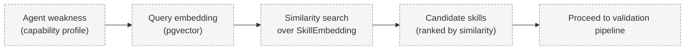

# Skill Discovery

> Status: **Proposed.**

## Problem

Given an agent's weak capability, PROMETHEUS must find relevant candidate skills. This is a
retrieval problem, not a quality problem.

## Context

- Agents detect weaknesses via self-assessment or benchmark results.
- The registry stores embeddings of skill versions.
- Retrieval must suggest candidates that are *relevant*, which are then *validated* separately.

## Design

### Relevance Retrieval



The retrieval step answers **"Which skills appear relevant?"**.

### Explicit Non-Equivalence

> **VectorSimilarity != SkillQuality**

Vector search may retrieve a skill that is topically similar but does not improve the agent on
unseen tasks. Therefore retrieval is only the entry point to the
[validation pipeline](skill-validation.md), which measures actual improvement.

## Responsibilities

- Embed the agent's weakness/profile into a query vector.
- Retrieve and rank candidate skills by similarity.
- Apply filters (permissions, trust, compatibility) to narrow candidates.
- Hand candidates to validation; never install based on similarity alone.

## Data Flow

```
Weak capability → embedding → pgvector similarity → candidates → validation
```

## Trade-offs

- Pure similarity is cheap but noisy; combining filters improves precision at some recall cost.
- Embedding quality determines retrieval quality; embedding model choice is consequential.

## Open Questions

- What text/representation is embedded for a skill (instructions, metadata, or both)?
- How are multiple capability dimensions combined into a query?
- How is diversity among candidates enforced?

## Related Documents

- [Skill Validation](skill-validation.md)
- [Skill Registry](skill-registry.md)
- [Skill Transfer](skill-transfer.md)
- [ADR-003 pgvector](../decisions/ADR-003-pgvector.md)
