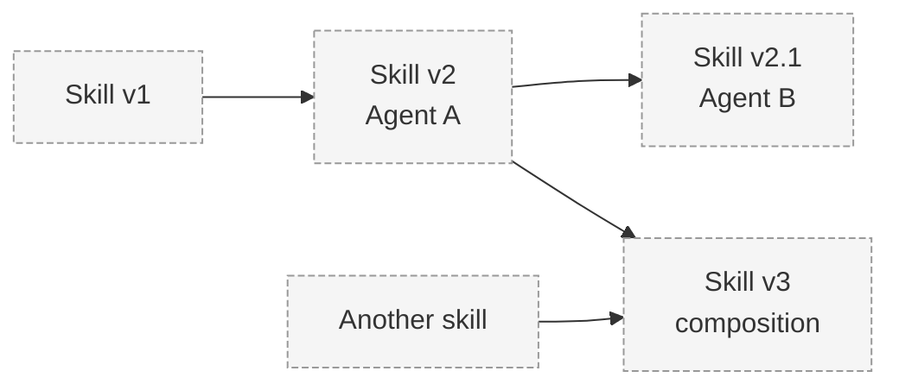

# Skill Lineage

> Status: **Proposed.**

## Problem

Skills evolve: they are improved, modified, and combined. Without lineage, capability provenance
is lost and trust cannot be reasoned about. PROMETHEUS must make skill ancestry visible.

## Context

- Multiple agents may modify a skill over time.
- Composed skills derive from more than one parent.
- Provenance and permissions should be traceable through versions.

## Design

### Versioning and Ancestry

```
Skill v1
  → Agent A improves it → Skill v2
Skill v2
  → Agent B modifies it → Skill v2.1
Skill v2 + another skill
  → composition → Skill v3
```

### Lineage Metadata (Proposed)

| Field | Meaning |
|-------|---------|
| skill ID | Logical skill identity |
| version | Version identifier |
| creator agent | Agent that produced this version |
| parent skill(s) | Ancestor version(s) |
| hash | Content hash for integrity |
| timestamp | Creation time |
| permissions | Declared permissions |
| benchmark results | Validation/benchmark outcomes |
| provenance | Origin and trust information |

### Example Lineage Graph



## Responsibilities

- The registry records lineage on publish; versions are immutable.
- PROMETHEUS renders lineage so ancestry is visible.
- Trust/provenance can propagate along lineage (mechanism **open** — see below).

## Data Flow

Publish with parent reference → registry records ancestry → lineage and network views render it.

## Security Considerations

- A derivative does not automatically inherit trust from its parent; trust propagation is an open
  question and must not be assumed.
- Content hashes help detect tampering.

## Trade-offs

- Rich lineage is more complex but enables evolution and auditability.
- Supporting composition multiplies lineage complexity.

## Open Questions

- Does trust propagate to derivatives, and under what conditions?
- How are conflicting concurrent versions reconciled?
- How is composition represented (single skill vs. a bundle)?
- How is lineage displayed for large graphs?

## Related Documents

- [Skill Specification](skill-specification.md)
- [Skill Registry](skill-registry.md)
- [Database Architecture](../architecture/database-architecture.md)
- [Research: Experiments](../research/experiments.md)
