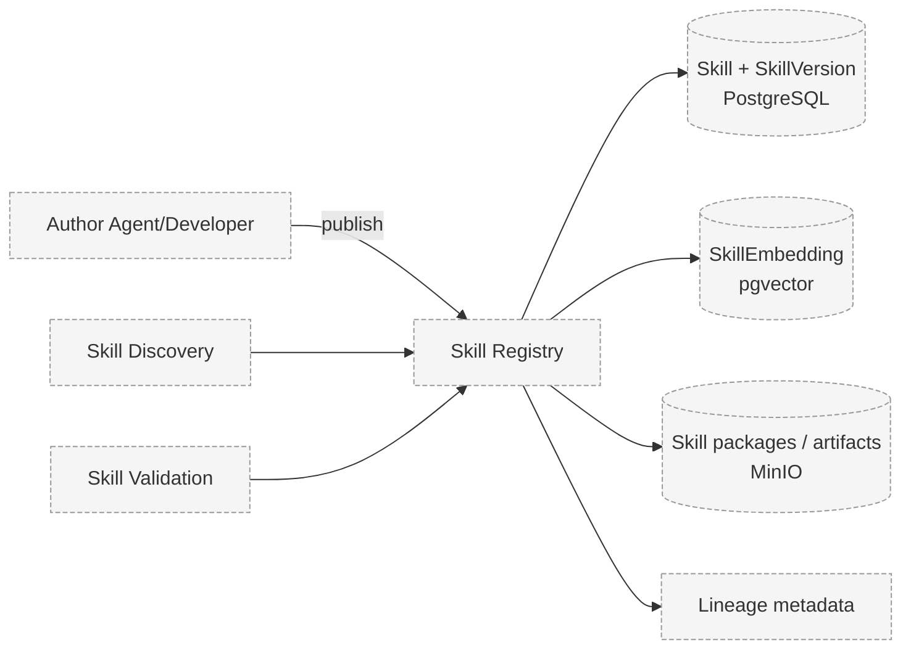

# Skill Registry

> Status: **Proposed.**

## Problem

Skills must be stored, discovered, versioned, and retrieved by relevance. Without a registry,
there is no shared place from which agents can discover capabilities.

## Context

- Skills are packages (see [Skill Specification](skill-specification.md)).
- Discovery needs vector embeddings for similarity search.
- Versioning and lineage must be preserved.
- Storage must keep relational metadata and vectors close (V1: PostgreSQL + pgvector).

## Design

The registry is the authoritative store of published, versioned skills. It provides:

- Create/read/update semantics where a published version is **immutable**.
- Versioning: new changes create a new `SkillVersion`, never mutate a published one.
- Embedding generation and storage for retrieval.
- Lineage metadata linking versions to parents.
- Validation status and trust/provenance information.



## Responsibilities

- Persist skills and their versions.
- Generate and store embeddings for retrieval.
- Enforce immutability of published versions.
- Expose retrieval endpoints for discovery.
- Record lineage and validation status.

## Data Flow

```
Publish → validate schema → store version → embed → index
Retrieve → embed query → pgvector similarity → candidate list
```

See [Data Flow — Skill Discovery and Transfer](../architecture/data-flow.md#flow-4--skill-discovery-and-transfer).

## Security Considerations

- Publishing runs schema validation; a malformed package is rejected before storage.
- Registry metadata is trusted; skill contents are not, until validated.
- Provenance is recorded for every version.

## Trade-offs

- Immutable versions improve auditability but require explicit new-version publishing.
- Storing vectors in PostgreSQL simplifies V1 but may be revisited at scale.

## Open Questions

- Is discovery global, per-organization, or per-agent-scope?
- How are skill namespaces and collisions handled?
- What retention policy applies to rejected/quarantined skills?

## Related Documents

- [Skill Specification](skill-specification.md)
- [Skill Discovery](skill-discovery.md)
- [Skill Lineage](skill-lineage.md)
- [ADR-003 pgvector](../decisions/ADR-003-pgvector.md)
