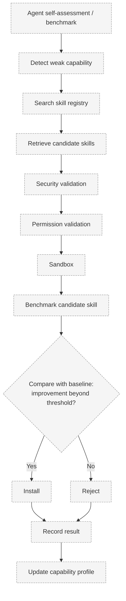

# Skill Transfer

> Status: **Proposed.**

## Problem

A capability learned by one agent should not have to be rediscovered by every other agent, even
when those agents use different models. Transfer must work across heterogeneous agents, and must
be proven to improve the **receiving** agent.

## Context

- Agents differ in model, tools, and runtime (see [Agent Adapter](../agents/agent-adapter.md)).
- A skill's success on Agent A does **not** prove it will improve Agent B.
- Transferred skills are untrusted and must pass the validation pipeline.

## Design

### Transfer Pipeline



### Heterogeneous Example

```
Claude-based Agent  →  skill  →  PROMETHEUS  →  Qwen-based Agent
```

The research question is whether the transferred skill improves the receiving agent on **unseen**
tasks, not tasks the skill was authored against.

### Evaluation Protocol

1. Benchmark receiving agent on a task set (baseline).
2. Retrieve candidate skill.
3. Validate the skill against the receiving agent in a sandbox.
4. If improvement exceeds the accepted threshold, install.
5. Re-benchmark on **unseen** tasks.
6. Record the before/after delta as the transfer result.

## Responsibilities

- Orchestration enforces security and permission validation before execution.
- The sandbox isolates candidate execution.
- Benchmarking provides the baseline and post-transfer measurements.
- The registry records installation and lineage.

## Data Flow

See [Data Flow — Skill Discovery and Transfer](../architecture/data-flow.md#flow-4--skill-discovery-and-transfer).

## Security Considerations

- Never install before validation.
- GitHub credentials are never exposed to the transferring or receiving agent.
- Rejected skills are quarantined, not silently dropped.

## Trade-offs

- Restricting validation to unseen tasks improves honesty but makes task design harder (avoiding
  contamination between authored and evaluation tasks).
- Cross-model transfer may require adapting instructions; over-adaptation can undermine the
  "portable" claim and must be reported.

## Open Questions

- What threshold constitutes meaningful improvement for V1?
- How are unseen tasks kept genuinely unseen from authoring?
- How should partial transfers (partial improvement) be represented?

## Related Documents

- [Skill Discovery](skill-discovery.md)
- [Skill Validation](skill-validation.md)
- [Benchmark Design](../benchmarks/benchmark-design.md)
- [Evaluation Metrics](../research/evaluation-metrics.md)
