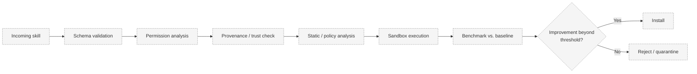

# Skill Validation

> Status: **Proposed.**

## Problem

A skill being successful on Agent A does **not** prove it will improve Agent B. PROMETHEUS must
measure whether a candidate skill actually improves a *specific* agent, safely, before
installation.

## Context

- Skills and their tests are untrusted code/data.
- Improvement must be measured against a baseline on comparable conditions.
- Validation must be reproducible and, where possible, deterministic.

## Design

### Skill Utility

PROMETHEUS evaluates:

```
SkillUtility(skill, agent)
```

rather than assuming universal skill quality.

### Validation Comparison

```
Existing Agent
  → Benchmark (baseline)

Candidate Skill
  → Sandbox
  → Benchmark same Agent

Compare results.
```

If the candidate skill produces meaningful improvement beyond an accepted threshold, it may be
installed. Otherwise it is rejected.

### Security Validation Pipeline



Stages are defined in
[Security Architecture § Proposed Validation Pipeline](../architecture/security-architecture.md#proposed-validation-pipeline).

## Responsibilities

- Orchestration runs the pipeline and makes the install/reject decision against a documented
  threshold.
- The sandbox executes the candidate and its tests in isolation.
- Benchmarking provides baseline and candidate measurements under matched conditions.
- The registry records validation results and install status.

## Data Flow

Baseline benchmark → candidate sandbox benchmark → comparison → decision → record.

## Security Considerations

- Validation executes untrusted content only in the sandbox, with no host secrets.
- Permission declarations are checked against policy; dangerous permissions are not silently
  granted.
- Failed validation leads to quarantine, not execution.

## Trade-offs

- Strict thresholds reduce false installs but may reject marginally useful skills.
- Sandboxed validation costs time and compute.

## Open Questions

- Exact threshold and its statistical justification.
- How many repeated runs are needed to reduce benchmark noise?
- How is improvement attributed to the skill rather than to random variation?
- Should validation results be portable (i.e., trusted across instances)?

## Related Documents

- [Security Architecture](../architecture/security-architecture.md)
- [Skill Transfer](skill-transfer.md)
- [Benchmark Execution](../benchmarks/benchmark-execution.md)
- [Evaluation Methodology](../benchmarks/evaluation-methodology.md)
- [ADR-006 Docker Sandbox](../decisions/ADR-006-docker-sandbox.md)
